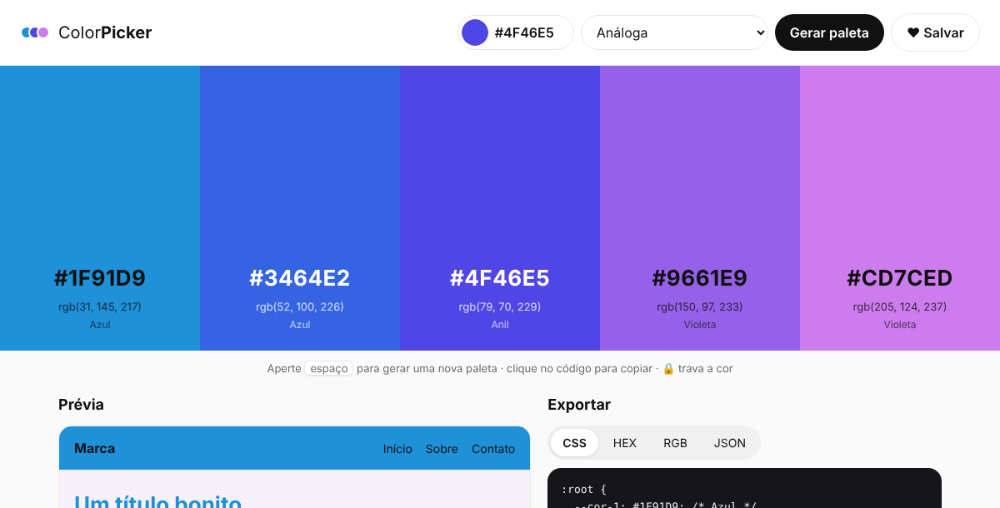

# ColorPicker — Gerador de paletas

Ferramenta de paletas que gera combinações harmônicas, copia HEX ou RGB com um clique e salva paletas favoritas.

🔗 **[Ver o site no ar](https://iamviniciuslima05.github.io/PROJETO-ColorPicker/)**



## Funcionalidades

- Paletas **análogas, complementares, triádicas, tetrádicas** e monocromáticas
- Gera paleta nova com a **barra de espaço**
- **Travar** cores que você gostou
- **Copiar HEX ou RGB** com um clique
- Nome aproximado de cada cor em português
- Texto com **contraste automático** (cálculo WCAG)
- **Prévia** da paleta aplicada numa interface
- **Exportar** em CSS, HEX, RGB ou JSON
- **Paletas salvas** no navegador

## Tecnologias

HTML5 · CSS3 · JavaScript · localStorage

## Estrutura

```
index.html
css/style.css
js/script.js
```

## Como rodar

Não precisa instalar nada: baixe o projeto e abra o `index.html` no navegador, ou acesse a versão publicada acima.

---
Feito por **Vinicius Lima** · [Portfólio](https://viniciuslimadev.netlify.app) · [LinkedIn](https://www.linkedin.com/in/viniciuslima25/)
